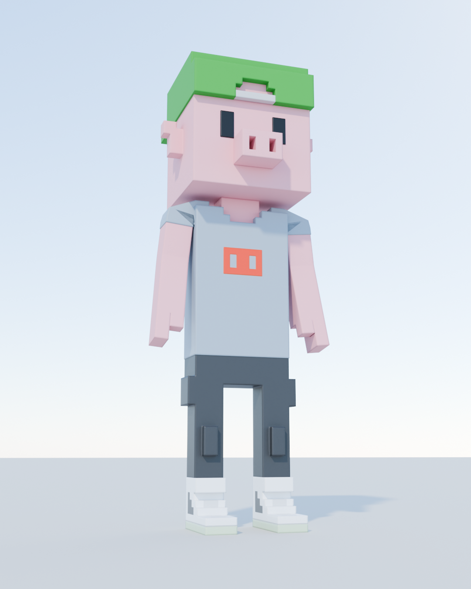
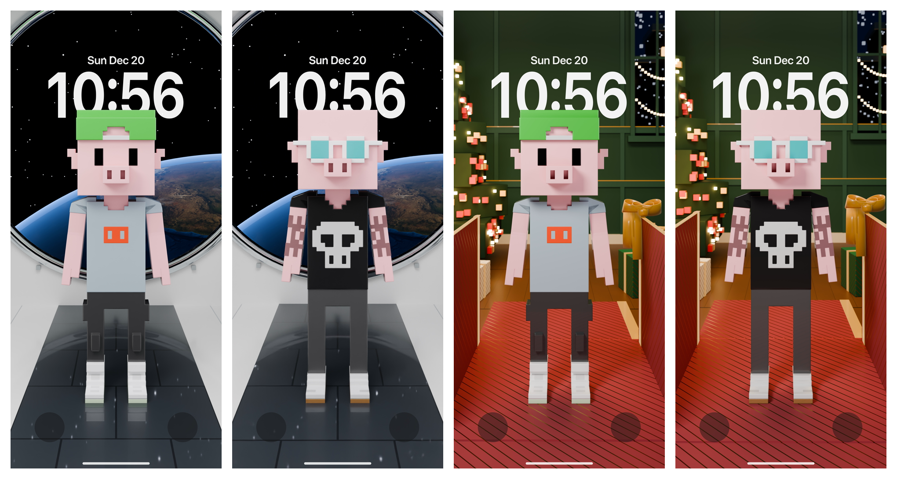
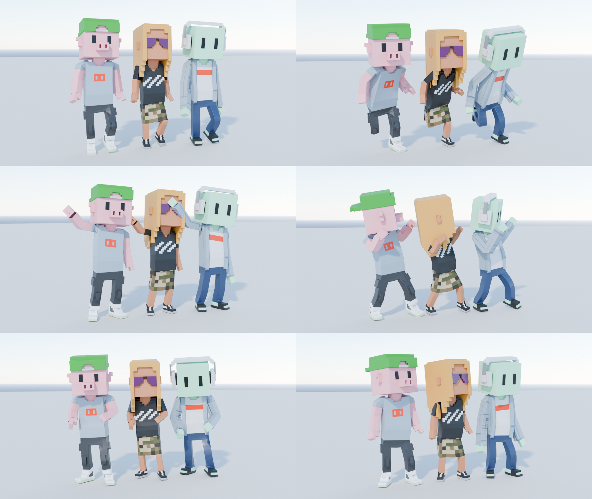

# Meebits Kit

Bring any Meebit into Blender or Unreal Engine by its token number.


Type a number and you get that Meebit at the right scale, with its own materials, in the standard
arms-down pose. Then make it move with any of the 23 motions Bailey made for MeebCo: idles, walks,
runs, chats, greetings and presenting gestures. In Blender, one more click sets up the house look MeebCo
uses for its films: AgX, a warm low sun, a plain floor and a camera at the Meebits' eye level. Every
image in this README was rendered by the kit itself.

| Where | What |
|---|---|
| [`blender/meebits_kit`](blender/meebits_kit) | The Blender add-on (Blender 4.2 or newer, tested on 5.2) |
| [`unreal`](unreal) | The Unreal Engine importer (tested on 5.9) |
| [`blender/meebits_kit/motions`](blender/meebits_kit/motions) | Bailey's 23 motions, as plain JSON any engine can read |
| [`tools/render.py`](tools/render.py) | Renders Meebits with the house look from the command line |
| [`tools/wallpaper.py`](tools/wallpaper.py) | Makes an iPhone spatial Lock Screen wallpaper of any Meebit |
| [`.claude/skills/meebit-wallpaper`](.claude/skills/meebit-wallpaper) | A Claude Code skill that makes the wallpaper for you |

## Blender

### Install

1. Build the add-on zip:

   ```bash
   blender --command extension build --source-dir blender/meebits_kit --output-dir dist
   ```

2. In Blender, go to Edit > Preferences > Get Extensions, open the menu in the top right corner, choose
   Install from Disk and pick `dist/meebits_kit-0.1.0.zip`.
3. Turn on Allow Online Access under Preferences > System. The kit downloads each Meebit from the MeebCo
   CDN the first time you load it and keeps a copy, so the second load works offline.

### Use

Open the sidebar in the 3D view (N) and find the Meebits tab.

- **Token**: the Meebit's token number, 1 to 20000.
- **Pose**: arms down (the standard pose) or the T-pose the model ships in.
- **Load Meebit** puts the Meebit at the 3D cursor, feet on the cursor, facing -Y. Load as many as you
  like; each one gets its own collection.
- **Pose Meebits** changes the pose of the selected Meebits.
- **Motion** and **Play Motion** put one of Bailey's motions on the selected Meebits; press Play in the
  timeline to watch. With **Walk forward** on, walks and runs carry the Meebit forward at the pace of
  its feet. **Stop** takes the motion off.
- **House Look** adds the lights, sky, floor and camera, sets AgX and Cycles, and frames every Meebit in
  the scene in a 4:5 portrait. Run it again after you move things and it reframes.
- **Render** renders the camera view.

The rig is still a normal armature, so you can pose it by hand or animate it from there.



### From the command line

```bash
blender -b --factory-startup --online-mode --python tools/render.py -- 8506 -o renders/08506.png
```

Give it several token numbers and they stand in a row, left to right as the camera sees them.
`--motion greet1 --frame 60` renders a moment from one of the motions. `--size 1920x1080`,
`--samples 256`, `--pose T_POSE` and `--blend scene.blend` do what they say.

### From your own scripts

```python
import sys
sys.path.insert(0, "/path/to/meebits-kit/blender")
from meebits_kit import core, look, motion

rig = core.load(8506)          # download, import, arms down; returns the armature
motion.apply(rig, "walk1")     # one of Bailey's motions, as an action on the rig
look.apply()                   # the house look, framing every Meebit in the scene
```

## iPhone spatial wallpapers



*Wallpapers made by the kit, with the Lock Screen clock and buttons drawn on top to show where they land.*

iOS 26 can turn a Lock Screen photo into a spatial scene: it cuts out the subject, slides the clock in
behind it and moves the layers as you tilt the phone. It works out the depth by itself, so the picture
has to separate cleanly on its own. We made a set of these for our own phones and kept what worked.

```bash
blender -b --factory-startup --online-mode --python tools/wallpaper.py -- 8506 --preview
blender -b --factory-startup --online-mode --python tools/wallpaper.py -- 8506
```

The first is a quick look at phone size. The second is the real one: `renders/08506_capsule_iphone.png`,
2640 x 5736, plus a 16-bit master, a mask of the Meebit and a report. AirDrop the `_iphone.png` to your
phone, add it as a Lock Screen wallpaper and turn on the spatial scene.

Two scenes so far:

- `--scene capsule` (the default): a white space capsule with its hatch open onto a close, detailed Earth,
  built in layers (surface, city lights, clouds, atmosphere) so the tilt has something to work with. The
  Earth maps are NASA's; the kit downloads them the first time, about 75 MB, and keeps them.
- `--scene giftbox`: your Meebit standing in an opened Christmas present with its back folded down flat, so
  the room shows behind its whole body: wrapped presents, a lit tree and snow outside the window.

What the kit takes care of, so you don't have to find it out the way we did:

- **The clock.** iOS zooms the wallpaper 1.15x. If the Meebit's head covers too much of the digits, iOS
  puts the clock in front of it and the effect is gone. The kit frames every Meebit so its head overlaps
  the digits by about 17%, with its feet clear of the flashlight and camera buttons.
- **Sharpness.** iOS renders the cut-out subject much softer than the background. A phone-size file looked
  blurry on the phone; the same render at 2x looked sharp. So the phone file is the 2x render.
- **The cut-out.** The report measures how well the Meebit's outline stands out from the background, since
  a weak edge gives a ragged cut-out.
- **The look.** Eye level, a level camera, the Meebit's own colours with a polished plastic finish, lights
  that only touch the Meebit, and a dark area behind the clock so it stays readable.

**With Claude Code**: open Claude Code in this folder and ask for "a spatial wallpaper of Meebit 8506". The
[`meebit-wallpaper`](.claude/skills/meebit-wallpaper/SKILL.md) skill runs the preview, reads the checks,
renders the full size and tells you how to put it on your phone. To use it from any folder, copy
`.claude/skills/meebit-wallpaper` into `~/.claude/skills/`. The skill also lists what we learned, if you
want to build a scene of your own.

From your own scripts:

```python
from meebits_kit import wallpaper

wallpaper.make(8506, "giftbox", "renders")   # build, render, check; returns the report
wallpaper.build(8506, "capsule")             # or just build the scene and render it yourself
```

## Motions



Bailey made 23 motions for MeebCo: `idle1` to `idle5`, `walk1` to `walk5`, `run1` to `run3`, `chat1` to
`chat3`, `greet1` to `greet4` and `present1` to `present3`. Each comes in three versions, made for the
three Meebit skeletons: male (which Pigs, Elephants, Robots, Skeletons and Dissected Meebits share),
female and Visitor. The kit measures the Meebit's arms and picks the right one.

Greetings and presenting play once; everything else loops. Walks and runs are baked in place, with
their speed over the ground stored next to them. The files are plain JSON, and
[the format](blender/meebits_kit/motions/README.md) is documented, so you can play them anywhere.

## Unreal Engine

```text
py "/path/to/meebits-kit/unreal/meebits_kit_unreal.py" 8506
```

Type that into the Output Log with the command box set to Cmd. Once it finishes you have:

- `/Game/Meebits/Meebit_08506/Meebit_08506`: one skeletal mesh with a material slot for each part
- its skeleton and physics asset
- `ArmsDown`: an animation that holds the standard pose
- Bailey's 23 motions as animations (`idle1`, `walk1` and so on), in the version for this Meebit's
  skeleton. Walks and runs play in place
- the materials and textures (`head_BaseColor`, `head_ORM`, `head_Normal` and so on)

The Meebit is also placed in the open level, standing in the ArmsDown pose. It is in centimetres and,
like the mannequin's mesh, faces +Y. From Python you get more control:

```python
import meebits_kit_unreal as mk          # add the unreal folder to Project Settings > Python > Additional Paths
mk.import_meebit(8506, location=(0, 0, 0), yaw=-90)
mk.import_meebit(1, place=False)         # import only
mk.import_meebit(3, motions=["idle1", "walk1"])   # only these motions; motions="none" for none
```

You need the Python Editor Script Plugin turned on in the project, and Blender installed. You never
have to open Blender: Unreal's glTF importer can't read the web models as they are (meshopt geometry and
WebP textures), so the kit runs Blender in the background to write a plain copy first. It finds Blender
in the usual install places; if yours is somewhere else, set `MEEBITS_BLENDER` to the Blender program.

The rig uses the UE5 mannequin's 87 bone names. We haven't tested mannequin animations on it yet.

## The models

- The kit downloads the same files the MeebCo site uses:
  `https://cdn.meebco.com/meebco-site/glb/<token>.glb`, with the token as five digits (`08506.glb`).
  They are about 375 KB each.
- A Meebit is eight skinned parts (body, head, jaw, hat, upper, lower, legs, shoes), each with a base
  colour, an ORM map and a normal map, on one rig: 87 bones, or 95 for female Meebits.
- They come in a T-pose, in metres, facing -Y in Blender, with the Meebit's left side at +X.
- Downloads are cached in Blender's own folder for the add-on. Scripts outside the add-on use
  `~/Library/Caches/meebits-kit` on a Mac, `%LOCALAPPDATA%\meebits-kit` on Windows and
  `~/.cache/meebits-kit` on Linux. Set `MEEBITS_KIT_CACHE` to use another folder.
- No model files live in this repo.

## Rights

The MIT licence in this repo covers the kit's code and Bailey's motions, and nothing else. The Meebit
models are not part of this repo: the kit downloads them from the MeebCo CDN, and they stay under the
[Meebits NFT License Terms](https://meebits.com/legal/license). Use your Meebits as those terms allow.
This kit doesn't grant any new rights to the models or to the renders you make of them.

The motions were made by Bailey for MeebCo and are under the same MIT licence as the code.

The Earth in the wallpaper capsule uses NASA's Blue Marble, Black Marble and GEBCO relief maps (NASA
Visible Earth and Earth Observatory). They aren't in this repo either: the kit downloads them from NASA.
Credit NASA if you share an image that shows the Earth.

## Licence

[MIT](LICENSE), for the code and the motions.
