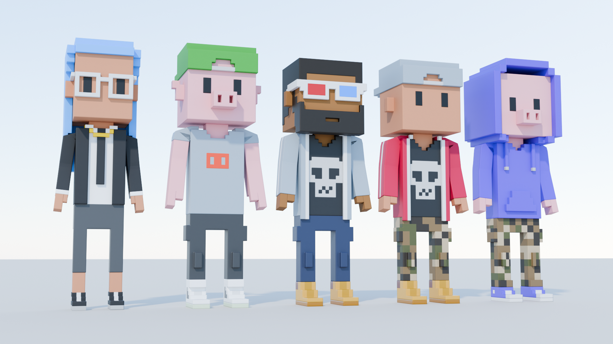

# Meebits Kit

Bring any Meebit into Blender or Unreal Engine by its token number.



Type a number and you get that Meebit at the right scale, with its own materials, in the standard
arms-down pose. In Blender, one more click sets up the house look MeebCo uses for its films: AgX, a
warm low sun, a plain floor and a low camera looking up. Every image in this README was rendered by
the kit itself.

| Where | What |
|---|---|
| [`blender/meebits_kit`](blender/meebits_kit) | The Blender add-on (Blender 4.2 or newer, tested on 5.2) |
| [`unreal`](unreal) | The Unreal Engine importer (tested on 5.9) |
| [`tools/render.py`](tools/render.py) | Renders Meebits with the house look from the command line |

## Blender

### Install

1. Build the add-on zip:

   ```bash
   blender --command extension build --source-dir blender/meebits_kit --output-dir dist
   ```

2. In Blender, go to Edit > Preferences > Get Extensions, open the menu in the top right corner, choose
   Install from Disk and pick `dist/meebits_kit-0.1.0.zip`.
3. Turn on Allow Online Access under Preferences > System. The kit downloads each Meebit from the MeebCo
   CDN the first time you load it and keeps a copy, so the second load works offline.

### Use

Open the sidebar in the 3D view (N) and find the Meebits tab.

- **Token**: the Meebit's token number, 1 to 20000.
- **Pose**: arms down (the standard pose) or the T-pose the model ships in.
- **Load Meebit** puts the Meebit at the 3D cursor, feet on the cursor, facing -Y. Load as many as you
  like; each one gets its own collection.
- **Pose Meebits** changes the pose of the selected Meebits.
- **House Look** adds the lights, sky, floor and camera, sets AgX and Cycles, and frames every Meebit in
  the scene in a 4:5 portrait. Run it again after you move things and it reframes.
- **Render** renders the camera view.

The rig is still a normal armature, so you can pose it by hand or animate it from there.


### From the command line

```bash
blender -b --factory-startup --online-mode --python tools/render.py -- 8506 -o renders/08506.png
```

Give it several token numbers and they stand in a row, left to right as the camera sees them.
`--size 1920x1080`, `--samples 256`, `--pose T_POSE` and `--blend scene.blend` do what they say.

### From your own scripts

```python
import sys
sys.path.insert(0, "/path/to/meebits-kit/blender")
from meebits_kit import core, look

rig = core.load(8506)          # download, import, arms down; returns the armature
look.apply()                   # the house look, framing every Meebit in the scene
```

## Unreal Engine

```text
py "/path/to/meebits-kit/unreal/meebits_kit_unreal.py" 8506
```

Type that into the Output Log with the command box set to Cmd. Once it finishes you have:

- `/Game/Meebits/Meebit_08506/Meebit_08506`: one skeletal mesh with a material slot for each part
- its skeleton and physics asset
- `ArmsDown`: an animation that holds the standard pose
- the materials and textures (`head_BaseColor`, `head_ORM`, `head_Normal` and so on)

The Meebit is also placed in the open level, standing in the ArmsDown pose. It is in centimetres and,
like the mannequin's mesh, faces +Y. From Python you get more control:

```python
import meebits_kit_unreal as mk          # add the unreal folder to Project Settings > Python > Additional Paths
mk.import_meebit(8506, location=(0, 0, 0), yaw=-90)
mk.import_meebit(1, place=False)         # import only
```

You need the Python Editor Script Plugin turned on in the project, and Blender installed. You never
have to open Blender: Unreal's glTF importer can't read the web models as they are (meshopt geometry and
WebP textures), so the kit runs Blender in the background to write a plain copy first. It finds Blender
in the usual install places; if yours is somewhere else, set `MEEBITS_BLENDER` to the Blender program.

The rig uses the UE5 mannequin's 87 bone names. We haven't tested mannequin animations on it yet.

## The models

- The kit downloads the same files the MeebCo site uses:
  `https://cdn.meebco.com/meebco-site/glb/<token>.glb`, with the token as five digits (`08506.glb`).
  They are about 375 KB each.
- A Meebit is eight skinned parts (body, head, jaw, hat, upper, lower, legs, shoes), each with a base
  colour, an ORM map and a normal map, on one 87-bone rig.
- They come in a T-pose, in metres, facing -Y in Blender, with the Meebit's left side at +X.
- Downloads are cached in Blender's own folder for the add-on. Scripts outside the add-on use
  `~/Library/Caches/meebits-kit` on a Mac, `%LOCALAPPDATA%\meebits-kit` on Windows and
  `~/.cache/meebits-kit` on Linux. Set `MEEBITS_KIT_CACHE` to use another folder.
- No model files live in this repo.

## Rights

The MIT licence in this repo covers the kit's code and nothing else. The Meebit models are not part of
this repo: the kit downloads them from the MeebCo CDN, and they stay under the Meebits licence terms.
<!-- REVIEW: add the link to the current Meebits licence terms here before this repo goes public. -->
Use your Meebits as those terms allow. This kit doesn't grant any new rights to the models or to the
renders you make of them.

## Licence

[MIT](LICENSE), for the code.
